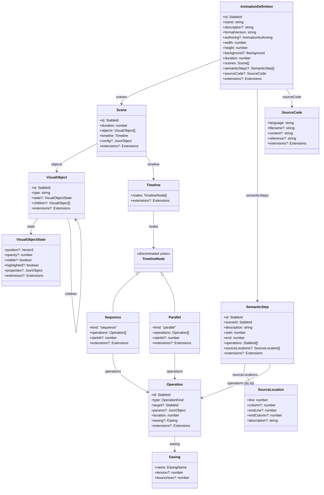

# Core domain model

This document describes the domain contracts owned by `@choreobit/core`. Core is
the **dependency root** of ChoreoBit: every other package builds on these types.
It is **data only** — core describes _what_ an animation contains. It does not
execute, interpolate, or render; those concerns live in
`@choreobit/animation`, `@choreobit/renderer`, `@choreobit/video`, and
`@choreobit/player`.

The model was designed around two principles:

- **Renderer-agnostic and portable.** A definition is a JSON-serializable
  document. The same definition can be rendered to video, streamed, or stepped
  through interactively, and the same definition reads the same on any backend.
- **Educational, not just mechanical.** The model separates _visual
  operations_ (a pointer moves, a cell highlights) from _semantic algorithm
  steps_ ("compute the midpoint"). The latter are the units a student
  understands; the former are the frames that express them.

## Design decisions

| Decision      | Choice                                                                                     | Rationale                                                                                                                                                                                                                      |
| ------------- | ------------------------------------------------------------------------------------------ | ------------------------------------------------------------------------------------------------------------------------------------------------------------------------------------------------------------------------------ |
| Time          | A plain `number` in **seconds**; no frame-rate field                                       | No unit string and no `timebase`; a consumer backend chooses a frame rate. Keeps the model deterministic and frame-rate independent.                                                                                           |
| Dimensions    | Plain numbers in logical units                                                             | A renderer maps logical units to pixels. Core carries no pixel data.                                                                                                                                                           |
| Extensibility | Optional `extensions?: { [key: string]: JsonValue }` on every major node                   | New fields can be added by a vendor or a newer author without changing core. Unknown `extensions` are preserved on round-trip.                                                                                                 |
| Identifiers   | `StableId = string`, unique within scope                                                   | Stable across authoring and playback so a player can reference operations and steps by id.                                                                                                                                     |
| Operations    | Closed common set + free-form `params`                                                     | Core names a concrete `OperationKind` set so the contract stays concrete, while `params: JsonObject` lets any kind carry arbitrary data. An unknown `type` is **rejected** by validation (unlike an unknown `extensions` key). |
| Timeline      | Flat, ordered list of `Sequence`/`Parallel` nodes                                          | Serializable (no nested closures) and deterministic (list order is execution order). Nodes are a discriminated union on `kind`. Node `startAt` is relative to the scene; independent nodes may overlap.                        |
| Semantics     | A `SemanticStep` names a `sceneId` and maps to many operations _and_ many source locations | A step ("narrow the range") drives several operations over many frames within one scene; a step can also map to several source lines, and several steps can map to one line.                                                   |
| JSON purity   | Every field is JSON-serializable by construction                                           | No field holds a function, class instance, or environment-specific object. `validateAnimationDefinition` rejects a non-JSON member.                                                                                            |
| Validation    | Lightweight, zero-dependency, structural + timing invariants                               | A shape and timing check guards a corrupt document. Core rejects unrecognised operation kinds and out-of-range timings; consumers may add deeper semantic validation (e.g. that every operation target exists).                |
| Rendering     | No renderer interfaces in core                                                             | Out of scope for Task 0.3 (spec §8).                                                                                                                                                                                           |
| Execution     | No runtime, no interpolation                                                               | Core defines the scheduling rules as data; the future `@choreobit/animation` package interprets them. No runtime, no clock.                                                                                                    |

## Model overview



The dashed arrow from `SemanticStep` to `Operation` is **by id**: a step lists
operation ids, not the operations themselves. This is what decouples the
semantic layer (what the algorithm is doing) from the visual layer (how it is
animated).

## The contracts

### `AnimationDefinition`

The top-level, portable document. Fields:

- `id` — a `StableId`, unique and stable across authoring and playback.
- `name`, `description` — human-readable.
- `formatVersion` — a version string; consumers compare it against
  `ANIMATION_DEFINITION_FORMAT_VERSION` (`'1.0.0'`) to detect incompatible
  definitions.
- `authoring?` — `AnimationAuthoring` (`author?`, `createdAt?`, `metadata?`).
- `width`, `height` — the logical canvas size, in logical units.
- `background?` — a `Background` (`kind`, plus `color`/`stops`/`angle`).
- `duration` — the authoritative total duration, in seconds. This must equal the
  sum of the scenes' `duration`s (see [Duration and validation](#duration-and-validation)).
- `scenes` — the ordered scenes that make up the animation.
- `semanticSteps?` — the ordered algorithm steps.
- `sourceCode?` — the source-code presentation.
- `extensions?` — vendor/extension data.

There is **no frame-rate field** and **no `timebase`**. Every timing value is a
plain number in seconds; see [Time representation](#time-representation).

### `Scene`

An ordered container of `VisualObject`s and a `Timeline`. Scenes execute one after
another in array order, so a definition can present a concept in stages. A scene
carries its own `duration`; its timeline's end time should not exceed it.
`config?` is free-form JSON for scene-level metadata (a caption, a transition).

### `VisualObject` and `VisualObjectState`

A visual object is identified by `id` and a free-form `type` string. Core does
**not** enumerate primitives: `'array'`, `'array.cell'`, `'pointer'`,
`'text.label'`, or a vendor type are all valid. A renderer decides what each type
means. `state?` is a `VisualObjectState`:

- `position?` — a `Vector2` (logical units).
- `opacity?` — a number in `[0, 1]`.
- `visible?`, `highlighted?` — booleans.
- `properties?` — free-form JSON for type-specific data (a cell's `value`, a
  label's `text`).
- `children?` — nested objects, so a scene can hold a tree (an array of cells).

### `Timeline`, `Sequence`, `Parallel`, `Operation`

A `Timeline` is a flat, ordered list of `TimelineNode`s. A node is a
discriminated union on `kind`:

- `Sequence` (`kind: 'sequence'`) — operations that advance one after another.
- `Parallel` (`kind: 'parallel'`) — operations that advance concurrently.

Each `Operation` carries:

- `id` — unique within its scene.
- `type` — an `OperationKind`: `'move' | 'set' | 'highlight' | 'setVisible' |
'transform' | 'addObject' | 'removeObject' | 'connect' | 'disconnect' |
'annotation'`.
- `target?` — the object id the operation acts on; absent for scene-level
  operations such as `addObject`/`removeObject`, which carry the affected ids in
  `params`.
- `params?` — free-form JSON.
- `duration` — in seconds; `duration: 0` is an instantaneous change.
- `easing?` — an `Easing` (`name` plus optional `tension`/`bounciness`).

An operation has **no start time of its own**: when an operation begins is a
property of the container that holds it. See [Timeline scheduling](#timeline-scheduling).

`Sequence` and `Parallel` both carry a `startAt?` (seconds, relative to the
containing scene; omitted means `0`) and an `operations` list.

An operation `type` that is not one of the recognised `OperationKind`s is
**rejected** by `validateAnimationDefinition` (it is a structural error). This is
distinct from an unknown key inside an `extensions` map, which is preserved.
Operation-specific _parameter interpretation_ is **not** core's concern:
`params` is free-form JSON and a consumer package decides what `{ x, y }` means
for `move` or `{ name, value }` for `set`.

### `SemanticStep`

A semantic algorithm step: a meaningful unit of an algorithm that may span many
frames. It is **not** a frame. A step:

- names the scene it belongs to via a **required `sceneId`**; its `start`/`end`
  are measured within that scene's timeline, so a step is unambiguously located
  even when a definition has several scenes.
- has **required `start`** and **`end`** (seconds, scene-relative), which position
  the step even when it drives no visible animation.
- drive several `operations` (by id) over many frames;
- map to several `sourceLocations`;
- be a pure reasoning step with **no** operations and **no** source reference.

The mapping between source lines and steps is intentionally many-to-many.

`SemanticSteps` is the optional container (`steps` + `extensions`); the
definition itself exposes the steps as `semanticSteps?`, in execution order.

### `SourceCode` and `SourceLocation`

`SourceCode` is data only: a `language` plus either inlined `content` or an
external `reference`/`filename`. Core does not parse, highlight, or edit code.
A `SourceLocation` is a 1-based line/column (with optional `endLine`/`endColumn`
for a range). The mapping from steps to source lives on each step's
`sourceLocations`, so a step can reference several lines and several steps can
reference the same line.

## Timeline scheduling

Core defines the scheduling semantics as **data**. It computes nothing at runtime;
the future `@choreobit/animation` package interprets these rules. The rules:

- **Operations have durations, not individual start timestamps.** When an
  operation begins is determined by its container.
- **`Sequence`: operations run consecutively in array order.** The first
  operation begins at the sequence's `startAt`; each subsequent operation begins
  exactly when the previous one finishes. The sequence's **duration is the sum of
  its operations' durations**, and its end time is `startAt` + that sum.
- **`Parallel`: operations run simultaneously.** Every operation begins at the
  group's `startAt` and runs for its own duration, so operations with different
  durations end at different times. The group's **duration is the maximum of its
  operations' durations**, and its end time is `startAt` + that maximum.
- **`startAt` is relative to the containing scene.** An omitted `startAt` means
  `0`.
- **Independent top-level nodes are not chained.** Their start times are not
  constrained by array order, so two top-level nodes may overlap on the scene
  timeline. Consecutiveness and simultaneity are properties of the _node kind_
  (`Sequence` vs `Parallel`), not of list ordering.

**Worked example.** A scene timeline with two top-level nodes:

```
Sequence A  startAt: 0
  op-1  duration 0.5   → occupies [0.0, 0.5)
  op-2  duration 0.3   → occupies [0.5, 0.8)
  op-3  duration 0.2   → occupies [0.8, 1.0)
  A ends at 1.0  (0 + 0.5 + 0.3 + 0.2)

Parallel B  startAt: 0.5
  op-4  duration 0.4   → occupies [0.5, 0.9)
  op-5  duration 0.3   → occupies [0.5, 0.8)
  B ends at 0.8  (0.5 + max(0.4, 0.3))
```

The offset of the `n`th operation in a sequence is `startAt` plus the sum of the
durations of the operations before it. `A` and `B` are independent top-level
nodes: they overlap (`B` begins at `0.5`, mid-way through `A`) and neither is
chained to the other.

## Time representation

- **All authored time values are seconds.** Durations and timestamps
  (`startAt`, `start`, `end`, scene `duration`, animation `duration`) are plain
  numbers in seconds.
- **There is no `timebase` and no frame-rate field** in the definition.
- **Video consumers select their own output frame rate.** The same authored
  definition can be rendered at 24, 30, or 60 FPS — or stepped through
  interactively — without any of its timing values changing: the consuming backend
  converts a time `t` to a frame index as it renders.

## Duration and validation

`validateAnimationDefinition(value, options?)` is a structural, zero-dependency
check that also enforces the timing invariants below. It returns
`{ valid, errors }`. The invariants it enforces:

- **Finite, non-negative.** Every duration and timestamp is a finite,
  non-negative number (`Number.isFinite` and `>= 0`). This covers operation
  `duration`, node `startAt`, animation `duration`, scene `duration`, and a step's
  `start`/`end`.
- **Animation duration equals the sum of scene durations.**
  `def.duration` must equal the sum of the scenes' `duration`s, within
  `DURATION_TOLERANCE` (`1e-9` seconds). If a scene `duration` is not finite and
  non-negative, the sum check is skipped for that scene.
- **Timeline nodes finish within their scene.** A node's end time (a sequence's
  `startAt` + sum of operation durations; a parallel's `startAt` + max
  operation duration) must not exceed its scene's `duration`, within
  `DURATION_TOLERANCE`.
- **Semantic steps finish within their scene.** A step's `end` must not exceed the
  `duration` of the scene named by its `sceneId`, within `DURATION_TOLERANCE`.
- **Semantic step start does not exceed end.** A step's `start` must not be
  greater than its `end`, within `DURATION_TOLERANCE`.
- **Recognised operation kinds.** Every operation's `type` must be one of the
  ten `OperationKind`s (`move`, `set`, `highlight`, `setVisible`, `transform`,
  `addObject`, `removeObject`, `connect`, `disconnect`, `annotation`). An
  unrecognised `type` is a structural error, **rejected** by validation.
- **Scene association.** A semantic step's `sceneId` must name an existing scene
  id.
- **Format version.** `formatVersion` must match `options.expectedVersion`
  (default `ANIMATION_DEFINITION_FORMAT_VERSION`, `'1.0.0'`).
- **No non-JSON member.** No field holds a function, `symbol`, or class instance;
  `validateAnimationDefinition` rejects one.

The comparison tolerance is the exported constant `DURATION_TOLERANCE = 1e-9`.
It is used only to compare sums and end-times; it never coerces a value.

Validation is structural plus these timing invariants, **not fully semantic**: it
does not check that an operation's `target` or a step's `operations` reference
real ids, and it does **not** validate that an operation's `params` are
meaningful for its `type` (operation-specific parameter validation is **not**
implemented). Consumers may add those deeper checks on top.

## Serialization and compatibility

`@choreobit/core` exports three helpers:

- `serializeDefinition(def)` — `JSON.stringify(def, null, 2)`. **Object key order
  is the object's own insertion order; no canonical sorting is performed.** Two
  objects built with the same key order serialise identically, but two objects
  with the same fields in a different key order do **not** produce identical
  bytes. The function makes no promise of byte-identical output across authoring
  runs.
- `parseDefinition(json)` — `JSON.parse` to a definition; throws on malformed
  JSON. The result never contains a function, `symbol`, or class instance.
- `validateAnimationDefinition(value, options?)` — see [Duration and
  validation](#duration-and-validation).

**Extension fields vs operation kinds.** An unknown key inside an `extensions`
map is **preserved** and accepted on round-trip (forward compatibility). An
unrecognised operation `type`, by contrast, is **rejected** by validation. The
two are distinct: extensibility applies to vendor data, not to the closed
`OperationKind` set.

**JSON serialization limitations.** `JSON.stringify` omits properties whose value
is `undefined`, so they do not survive a round trip. Functions, `symbol`s, class
instances, and other non-JSON values are dropped on the way out and cannot be
recovered on the way in. Because of these limits, run
`validateAnimationDefinition` **before** serialising a hand-authored in-memory
definition: it rejects non-JSON members so the caller knows the document is safe
to serialise.

## What core does not own

Per the task scope (spec §7–§8):

- **No execution.** Core has no runtime and no clock.
- **No interpolation.** Core carries keyframe-like operations; it does not compute
  intermediate values.
- **No rendering.** Core has no canvas, no pixels, no renderer interface.
- **No authoring DSL.** Core is the document the DSL produces, not the DSL itself.

These live in `@choreobit/animation` (runtime, interpolation),
`@choreobit/renderer` (rendering backends), `@choreobit/video`, and
`@choreobit/player`. See `package-boundaries.md` for the full package graph.

## Source layout

```
packages/core/src/
├── index.ts                 # public API re-exports
├── definitions/
│   ├── common.ts            # StableId, Vector2, Transform, Easing, JsonValue, JsonObject
│   ├── animation.ts         # AnimationDefinition, AnimationAuthoring, Background, version
│   ├── scene.ts             # Scene
│   ├── object.ts            # VisualObject, VisualObjectState
│   ├── timeline.ts          # Operation, Sequence, Parallel, TimelineNode, Timeline
│   ├── semantic-step.ts     # SemanticStep, SemanticSteps
│   └── source-code.ts       # SourceCode, SourceLocation
├── serialization/
│   └── types.ts             # serializeDefinition, parseDefinition, validateAnimationDefinition
└── __tests__/
    └── contracts.test.ts    # the contract test suite
```

## Tests

`packages/core/src/__tests__/contracts.test.ts` is built around a single
`binarySearchDefinition()` fixture (a two-scene binary-search animation with a
timeline and five semantic steps) and is organised into four `describe` blocks:

**core domain contracts**

1. Represents a minimal valid animation definition.
2. Supports multiple scenes in authoring order.
3. Allows a scene to contain multiple visual objects.
4. Supports objects with different type identifiers.
5. Lets timeline operations target multiple objects.
6. Represents concurrent operations that share a start time.
7. Lets a semantic step reference multiple operations.
8. Lets a semantic step reference multiple source-code lines.
9. Lets multiple semantic steps reference the same source line.
10. Supports a non-visual semantic step (no visible animation).
11. Survives JSON serialization and deserialization.
12. Preserves stable identifiers across round trips.
13. Rejects structurally invalid data when validation is enabled.
14. Rejects a non-JSON member (a function) in the definition.
15. Preserves unknown extension fields (forward compatibility).
16. Rejects an incompatible format version.

**timeline scheduling semantics**

17. Chains sequence operations consecutively from `startAt`.
18. Ends a sequence at the sum of its operations' durations.
19. Starts parallel operations simultaneously.
20. Ends a parallel at its longest operation duration.
21. Treats an omitted `startAt` as 0.
22. Allows overlapping top-level nodes.

**operation-kind recognition**

23. Rejects an operation whose `type` is not a recognised kind.
24. Accepts every recognised operation kind.

**duration consistency**

25. Accepts a definition whose total duration equals the scene sum.
26. Rejects a total duration that is not the sum of scene durations.
27. Rejects a node whose end time exceeds its scene duration.
28. Rejects a step whose end exceeds its scene duration.

Run them with `pnpm test` from the repository root.
