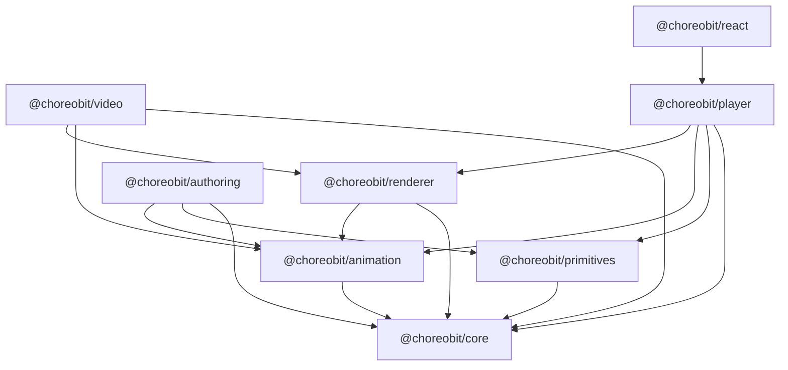

# ChoreoBit — Package Boundaries

This document defines the package architecture for ChoreoBit. It is the
authoritative reference for package responsibilities, the dependency graph,
public API ownership, and the browser/Node boundary.

Status: runtime chain through the video frame renderer. `core`, `primitives`,
`animation`, `renderer`, `authoring`, and `video` each ship source and a built
`dist/`; `player` and `react` remain to be built (see §7).

## 1. Package responsibilities

| Package                 | Responsibility                                                                                                                                                                                                                                                                                                                                                                                                                                                                                                                                              |
| ----------------------- | ----------------------------------------------------------------------------------------------------------------------------------------------------------------------------------------------------------------------------------------------------------------------------------------------------------------------------------------------------------------------------------------------------------------------------------------------------------------------------------------------------------------------------------------------------------- |
| `@choreobit/core`       | Dependency root. Shared domain types, animation state model, timeline abstractions, and common runtime contracts. No internal ChoreoBit dependencies.                                                                                                                                                                                                                                                                                                                                                                                                       |
| `@choreobit/primitives` | Reusable visual objects: arrays, linked lists, trees, graphs, heaps, stacks, queues, matrices, pointers, edges, labels. Reusable across algorithms.                                                                                                                                                                                                                                                                                                                                                                                                         |
| `@choreobit/animation`  | Animation operations: interpolation, easing, transitions, sequential/parallel composition, lifecycle abstractions.                                                                                                                                                                                                                                                                                                                                                                                                                                          |
| `@choreobit/renderer`   | Rendering: a Canvas 2D backend that draws a `SceneVisualState` onto a structural `Canvas2DContext`. Backend-agnostic by design; a concrete alternative backend (e.g. PixiJS) is a separate concern.                                                                                                                                                                                                                                                                                                                                                         |
| `@choreobit/authoring`  | Developer-facing TypeScript API: scene authoring, animation composition, scene definitions. Expressive API inspired by Manim.                                                                                                                                                                                                                                                                                                                                                                                                                               |
| `@choreobit/video`      | Video production: frame rendering orchestration, audio/narration integration, video encoding, export profiles. Node.js environment.                                                                                                                                                                                                                                                                                                                                                                                                                         |
| `@choreobit/player`     | Browser playback runtime: a frame-clock-driven animation loop (play, pause, restart, seek, loop, playback rate, subscribe, semantic stepping) that schedules a scene's timeline once and renders each frame via `renderer`. Also owns the code synchronizer (`resolveCodeSync`/`createCodeSyncResolver`), which maps the player's clock to active semantic steps and source locations, and the semantic stepper (`resolveStepStops`/`createSemanticStepper`), which navigates between those steps' start times via `seek`. No video authoring dependencies. |
| `@choreobit/react`      | Optional React integration: components for embedding ChoreoBit animations in a website. React is a peer dependency.                                                                                                                                                                                                                                                                                                                                                                                                                                         |

## 2. Dependency graph

## 3. Dependency rules

- `core` has **no** internal ChoreoBit dependencies. It is the acyclic root.
- `primitives` and `animation` depend only on `core`.
- `renderer` depends on `core` and `animation`: it draws the `SceneVisualState`
  that `animation` produces, against a structural `Canvas2DContext`.
- `authoring` depends on `core`, `primitives`, and `animation`.
- `video` depends on `core`, `animation`, and `renderer`: it schedules and
  evaluates each scene (via `animation`) and draws the result (via `renderer`),
  stitching the pipeline into a frame sequence.
- `player` depends on `core`, `primitives`, `animation`, and `renderer`.
- `react` depends only on `player`.
- No package may depend on a package that is not listed for it in `scripts/check-deps.mjs`.
- No cycles are permitted. The graph is a DAG.
- Internal dependencies are declared as `workspace:*` so the monorepo builds from source.
- The full approved edge set is enforced by `pnpm check:deps` (run in CI).

## 4. Public API ownership

| Concern                                                                                     | Owner package |
| ------------------------------------------------------------------------------------------- | ------------- |
| Shared domain types, state model, timeline abstractions, runtime contracts                  | `core`        |
| Visual object definitions (arrays, trees, graphs, …)                                        | `primitives`  |
| Animation definitions (interpolation, easing, composition, lifecycle)                       | `animation`   |
| Rendering interfaces (surface, coordinate transforms, backend contract)                     | `renderer`    |
| Authoring abstractions (scene authoring, composition helpers)                               | `authoring`   |
| Video-specific functionality (frame orchestration, audio, encoding, export)                 | `video`       |
| Browser playback (the animation loop: play, pause, restart, seek, loop, rate, subscribe)    | `player`      |
| Code synchronization (mapping the player's clock to active semantic steps and source lines) | `player`      |
| Semantic stepping (navigating between a scene's step start times via `seek`)                | `player`      |
| React integration (embedding components)                                                    | `react`       |

Rules:

- Shared types live in exactly one package (normally `core`) and are re-exported,
  never duplicated.
- A package exposes only its public entry point; internal source paths are not
  importable by consumers.
- When a package gains source, its `exports` map and `types` field point to the
  built `dist/index.js` / `dist/index.d.ts`. Until then it has no source.

## 5. Browser versus Node.js boundaries

| Package      | Environment | Rationale                                                                                                                                                  |
| ------------ | ----------- | ---------------------------------------------------------------------------------------------------------------------------------------------------------- |
| `core`       | Universal   | Pure types and contracts; no environment assumptions.                                                                                                      |
| `primitives` | Universal   | Visual object definitions; no I/O.                                                                                                                         |
| `animation`  | Universal   | Pure computation.                                                                                                                                          |
| `renderer`   | Universal   | Backend-agnostic; a browser backend may be selected at runtime.                                                                                            |
| `authoring`  | Universal   | Pure data builders; it depends on no Node-only package, so a built `dist/` loads in a browser (see `browser-player`).                                      |
| `player`     | Browser     | Playback runtime. Must not pull in Node-only deps.                                                                                                         |
| `react`      | Browser     | UI embedding. `react` is a peer dependency.                                                                                                                |
| `video`      | Universal   | Frame rendering is backend-agnostic; a real canvas context or a mock both work. Audio, narration, and encoding are later layers that will bring Node APIs. |

`video` is the production end of the pipeline but, as built, it is
**browser-free and Node-free**: its frame renderer draws onto a structural
`Canvas2DContext` (which a real browser context and a test mock both satisfy) and
pulls in no Node-only dependency, so its built output could load in a browser.
It is _not_ in `BROWSER_PACKAGES`, though: the audio, narration, and encoding
layers that will be layered on the frame sequence are expected to use Node APIs,
so the package is reserved as Node-bound. `player` and `react` are the only
browser-facing runtime packages and are checked by `scripts/check-deps.mjs` for
absence of Node-only dependencies. `authoring` is universal: its builders produce
pure `core` data and it depends only on
`core`/`primitives`/`animation` (none Node-only), so its built output is importable
through a browser import map even though authoring is usually a build-time step.

## 6. Package interaction examples

These are illustrative call shapes only. No code is implemented.

- **Authoring a scene** (universal): `authoring` composes an
  `AnimationDefinition` from `primitives` objects, `animation`-style operations,
  semantic steps, and source code, producing a portable document owned by `core`
  contracts that both `video` and `player` consume.
- **Rendering a frame** (universal): `renderer` draws a scene onto a surface
  using coordinates and transforms defined in `core`/`renderer`.
- **Producing a video** (Node.js): `video` drives `renderer` frame by frame,
  mixes narration/audio, and encodes output.
- **Playing back** (browser): `player` consumes a `Scene`, schedules its timeline
  once, and drives a frame clock that evaluates and renders each frame via
  `renderer`, with play/pause/restart/seek/loop/rate controls.
- **Synchronising to source** (browser): the same `player` runs a
  `createCodeSyncResolver` over the scene's semantic steps, mapping the player's
  clock to the active steps and source lines a code viewer highlights — one
  clock, no second evaluator.
- **Embedding in a website** (browser): `react` wraps `player` in a component.

## 7. Architectural decisions and trade-offs

- **Separate `renderer` from `core`.** Rendering is a replaceable concern; the
  core API does not name any backend. A PixiJS backend, a canvas backend, or a
  server-side renderer can be swapped without touching `core` consumers.
- **`player` is independent of `video`.** Browser playback never imports the
  video authoring environment, so the browser bundle stays free of Node-only
  dependencies.
- **`react` is optional and a leaf.** It sits on top of `player` only, so
  non-React consumers and the core framework have no React dependency.
- **The code synchronizer lives in `player`, not a new package.** It is driven by
  the player's clock and reads the player's `PlayerState`, so it belongs where the
  clock lives. It is a pure, read-only view of that clock (a `resolve` function of
  time), never a second clock or evaluator, and introduces no new runtime or
  third-party dependency.
- **`authoring` depends on `primitives` and `animation`, not `renderer`.**
  Authoring produces data (animation definitions); it does not draw. Keeping
  rendering out of authoring keeps the same definition usable by both `video`
  and `player`.
- **Every runtime package builds a `dist/`.** `core`, `primitives`, `animation`,
  `renderer`, `authoring`, and `video` each ship an ESM `dist/index.js` plus
  `dist/index.d.ts`, so the CI build pipeline is exercised on real output across
  the whole runtime chain. `player` and `react` are the only packages still
  without source.
- **Lightweight enforcement over a framework.** A zero-dependency script
  (`scripts/check-deps.mjs`) plus `workspace:*` declarations enforce the graph
  and the browser/Node boundary without a heavy architecture tool.

## 8. Deferred decisions

- Concrete rendering backend (PixiJS vs canvas vs WebGPU) — chosen when
  `renderer` gains an implementation.
- Animation definition serialization format (the portable format consumed by
  `player`) — defined when the contract in `core` is designed.
- Video encoding backend, export profiles, audio, and narration — the deterministic
  frame renderer is built; these layers on the frame sequence are deferred.
- React version range and component surface — decided when `react` is built.
- Build orchestration across packages (e.g. Turborepo/nx) — deferred; the
  current `pnpm -r` approach suffices for the early stage.
- A formal `exports` map with subpaths — added per package as source lands.
