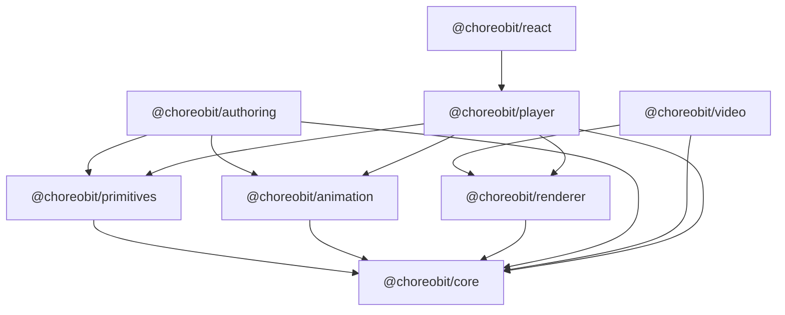

# ChoreoBit — Package Boundaries

This document defines the package architecture for ChoreoBit. It is the
authoritative reference for package responsibilities, the dependency graph,
public API ownership, and the browser/Node boundary.

Status: structural foundation (Task 0.2). No domain, animation, or rendering
code exists yet.

## 1. Package responsibilities

| Package                 | Responsibility                                                                                                                                                             |
| ----------------------- | -------------------------------------------------------------------------------------------------------------------------------------------------------------------------- |
| `@choreobit/core`       | Dependency root. Shared domain types, animation state model, timeline abstractions, and common runtime contracts. No internal ChoreoBit dependencies.                      |
| `@choreobit/primitives` | Reusable visual objects: arrays, linked lists, trees, graphs, heaps, stacks, queues, matrices, pointers, edges, labels. Reusable across algorithms.                        |
| `@choreobit/animation`  | Animation operations: interpolation, easing, transitions, sequential/parallel composition, lifecycle abstractions.                                                         |
| `@choreobit/renderer`   | Rendering abstractions, coordinate transformations, rendering surfaces, and a pluggable backend. Backend-agnostic; a concrete backend (e.g. PixiJS) is a separate concern. |
| `@choreobit/authoring`  | Developer-facing TypeScript API: scene authoring, animation composition, scene definitions. Expressive API inspired by Manim.                                              |
| `@choreobit/video`      | Video production: frame rendering orchestration, audio/narration integration, video encoding, export profiles. Node.js environment.                                        |
| `@choreobit/player`     | Browser playback runtime: playback controls, semantic stepping, seeking, code synchronization, animation definition consumption. No video authoring dependencies.          |
| `@choreobit/react`      | Optional React integration: components for embedding ChoreoBit animations in a website. React is a peer dependency.                                                        |

## 2. Dependency graph

## 3. Dependency rules

- `core` has **no** internal ChoreoBit dependencies. It is the acyclic root.
- `primitives`, `animation`, and `renderer` depend only on `core`.
- `authoring` depends on `core`, `primitives`, and `animation`.
- `video` depends on `core` and `renderer`.
- `player` depends on `core`, `primitives`, `animation`, and `renderer`.
- `react` depends only on `player`.
- No package may depend on a package that is not listed for it in `scripts/check-deps.mjs`.
- No cycles are permitted. The graph is a DAG.
- Internal dependencies are declared as `workspace:*` so the monorepo builds from source.
- The full approved edge set is enforced by `pnpm check:deps` (run in CI).

## 4. Public API ownership

| Concern                                                                           | Owner package |
| --------------------------------------------------------------------------------- | ------------- |
| Shared domain types, state model, timeline abstractions, runtime contracts        | `core`        |
| Visual object definitions (arrays, trees, graphs, …)                              | `primitives`  |
| Animation definitions (interpolation, easing, composition, lifecycle)             | `animation`   |
| Rendering interfaces (surface, coordinate transforms, backend contract)           | `renderer`    |
| Authoring abstractions (scene authoring, composition helpers)                     | `authoring`   |
| Video-specific functionality (frame orchestration, audio, encoding, export)       | `video`       |
| Browser playback (controls, stepping, seeking, code sync, definition consumption) | `player`      |
| React integration (embedding components)                                          | `react`       |

Rules:

- Shared types live in exactly one package (normally `core`) and are re-exported,
  never duplicated.
- A package exposes only its public entry point; internal source paths are not
  importable by consumers.
- When a package gains source, its `exports` map and `types` field point to the
  built `dist/index.js` / `dist/index.d.ts`. Until then it has no source.

## 5. Browser versus Node.js boundaries

| Package      | Environment | Rationale                                                       |
| ------------ | ----------- | --------------------------------------------------------------- |
| `core`       | Universal   | Pure types and contracts; no environment assumptions.           |
| `primitives` | Universal   | Visual object definitions; no I/O.                              |
| `animation`  | Universal   | Pure computation.                                               |
| `renderer`   | Universal   | Backend-agnostic; a browser backend may be selected at runtime. |
| `player`     | Browser     | Playback runtime. Must not pull in Node-only deps.              |
| `react`      | Browser     | UI embedding. `react` is a peer dependency.                     |
| `authoring`  | Node.js     | Authoring is a build-time authoring concern.                    |
| `video`      | Node.js     | Frame rendering, audio, and encoding use Node APIs.             |

`video` must not contaminate the browser playback runtime. `player` and `react`
are the only browser-facing runtime packages and are checked by
`scripts/check-deps.mjs` for absence of Node-only dependencies.

## 6. Package interaction examples

These are illustrative call shapes only. No code is implemented.

- **Authoring a scene** (Node.js): `authoring` composes a `Scene` from
  `primitives` and `animation` operations, producing an animation definition
  owned by `core` contracts.
- **Rendering a frame** (universal): `renderer` draws a scene onto a surface
  using coordinates and transforms defined in `core`/`renderer`.
- **Producing a video** (Node.js): `video` drives `renderer` frame by frame,
  mixes narration/audio, and encodes output.
- **Playing back** (browser): `player` consumes a portable animation
  definition, renders via `renderer`, and supports stepping/seeking/code sync.
- **Embedding in a website** (browser): `react` wraps `player` in a component.

## 7. Architectural decisions and trade-offs

- **Separate `renderer` from `core`.** Rendering is a replaceable concern; the
  core API does not name any backend. A PixiJS backend, a canvas backend, or a
  server-side renderer can be swapped without touching `core` consumers.
- **`player` is independent of `video`.** Browser playback never imports the
  video authoring environment, so the browser bundle stays free of Node-only
  dependencies.
- **`react` is optional and a leaf.** It sits on top of `player` only, so
  non-React consumers and the core framework have no React dependency.
- **`authoring` depends on `primitives` and `animation`, not `renderer`.**
  Authoring produces data (animation definitions); it does not draw. Keeping
  rendering out of authoring keeps the same definition usable by both `video`
  and `player`.
- **`core` is the sole buildable package for now.** It keeps the CI build
  pipeline exercised on real output; other packages add source later.
- **Lightweight enforcement over a framework.** A zero-dependency script
  (`scripts/check-deps.mjs`) plus `workspace:*` declarations enforce the graph
  and the browser/Node boundary without a heavy architecture tool.

## 8. Deferred decisions

- Concrete rendering backend (PixiJS vs canvas vs WebGPU) — chosen when
  `renderer` gains an implementation.
- Animation definition serialization format (the portable format consumed by
  `player`) — defined when the contract in `core` is designed.
- Video encoding backend and export profiles — chosen when `video` is built.
- React version range and component surface — decided when `react` is built.
- Build orchestration across packages (e.g. Turborepo/nx) — deferred; the
  current `pnpm -r` approach suffices for the early stage.
- A formal `exports` map with subpaths — added per package as source lands.
